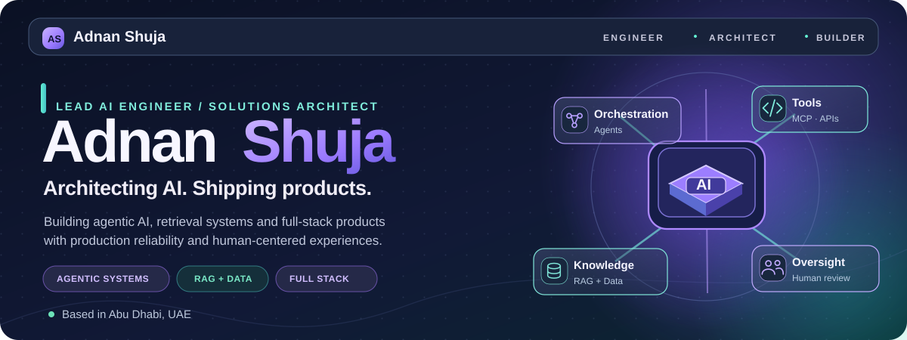
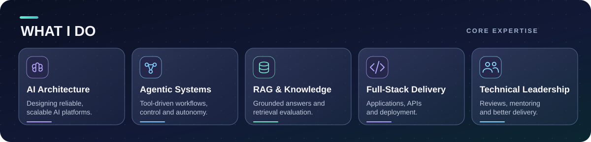
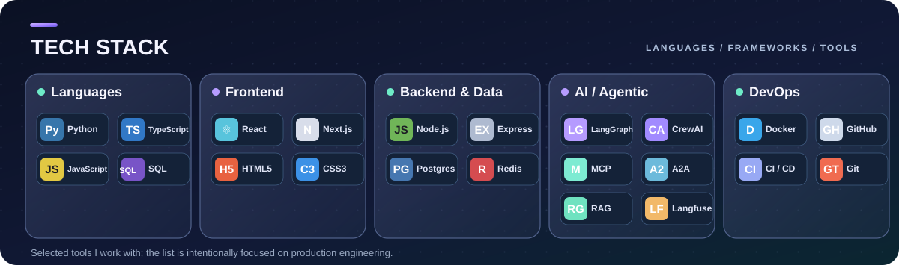
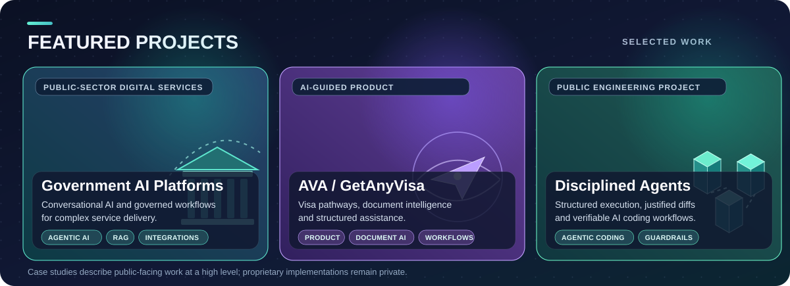
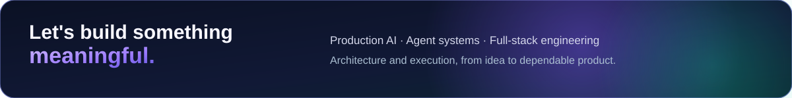

  

   

  
  
  

 

**I build production AI platforms and the full-stack applications around them.** My work spans agentic workflows, retrieval-augmented generation, APIs, product architecture and engineering leadership — from system design and pull requests through reliable delivery.

  

  

  
<strong>Engineering toolkit — accessible text version</strong>

  | Area | Technologies |
  | :-- | :-- |
  | Languages | TypeScript, JavaScript, Python, SQL |
  | Frontend | React, Next.js, HTML5, CSS3 |
  | Backend & data | Node.js, Express, PostgreSQL, Redis |
  | AI / agent systems | LangGraph, CrewAI, MCP, A2A, RAG, Pinecone, Qdrant, Langfuse |
  | DevOps | Docker, GitHub Actions, Git, CI/CD |

  

  
  

  
<strong>Read the engineering story behind the projects</strong>

  ### Government AI platforms
  **Professional engineering work · Implementation private**

  I work on conversational AI and agent-enabled public-sector digital services. My engineering focus includes retrieval grounding, controlled service integrations, workflow orchestration, observability and scalable delivery. Internal architecture and source code are not disclosed here.

  ### AVA / GetAnyVisa
  **AI product architecture · In development · Repositories private**

  An AI-guided visa journey product exploring pathway discovery, document understanding, policy-aware workflows and assisted operations. The goal is a clear, trustworthy user journey with explicit application state instead of relying on unconstrained model decisions.

  ### [Disciplined Agents](https://github.com/adnanshuja/disciplined-agents)
  **Public project · AI-assisted development discipline**

  A structured approach to coding-agent execution: defined scope, validation gates, traceable changes and per-diff justification. [Explore the source and documentation](https://github.com/adnanshuja/disciplined-agents).

### The way I build

| Architect | Engineer | Lead |
| :-- | :-- | :-- |
| Define trustworthy system boundaries, workflows and integration contracts. | Stay hands-on across AI, backend, frontend, testing and delivery. | Guide architecture, code reviews and mentoring across a multidisciplinary team. |

**What I optimize for:** grounded decisions, explicit workflow state, human approval for sensitive actions, usable products, observable systems and maintainable deployments.

  
   
   
  

Selected work is described at a high level. Private projects and proprietary implementations are not published. The diagrams are visual illustrations, not disclosures of production architecture.
