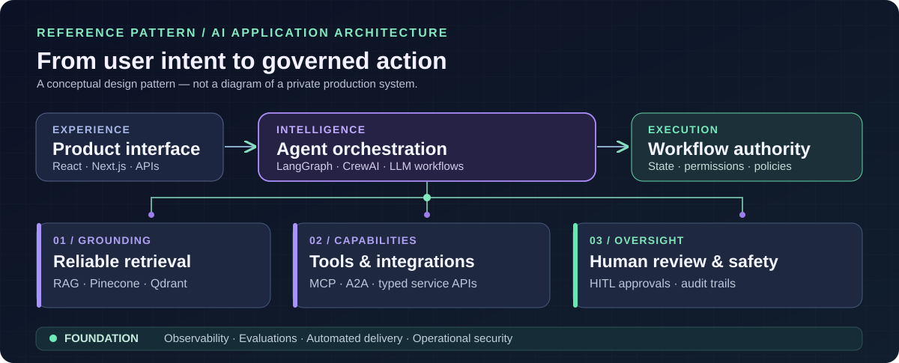

  

  
<strong>I engineer production AI platforms — from agent orchestration to the full-stack systems that make them usable.</strong>

  
10+ years of software engineering &nbsp;·&nbsp; AI platform architecture &nbsp;·&nbsp; Hands-on delivery &nbsp;·&nbsp; Engineering leadership

  

    
    
    
  

---

## About

I'm a **Lead AI Engineer / Solutions Architect** who is equally comfortable discussing system boundaries, reviewing a pull request, building APIs, or shipping a full-stack product.

My focus is **agentic AI, retrieval-augmented generation, AI-powered digital services, and reliable application architecture**. I work across product engineering, orchestration, knowledge retrieval, integrations, DevOps, and technical leadership.

> **Engineering principle:** Give AI the right context and capabilities. Keep critical state, permissions, and outcomes verifiable.

## Systems I design

**What matters beyond the model:** grounded responses, bounded tool execution, deterministic workflow state, explicit approval gates, traces, evaluation, and failure recovery.

## Selected work

### 01 / Government conversational AI & digital services
**Enterprise AI engineering** &nbsp;·&nbsp; **Professional experience** &nbsp;·&nbsp; **Implementation private**

**The challenge** — Digital public services need more than a chatbot: users need trustworthy information, clear next steps, and safe orchestration across many underlying services.

**My contribution** — Technical leadership and hands-on architecture for conversational AI, agentic workflows, RAG, platform integrations, and engineering delivery. I work across architecture decisions, code reviews, mentoring, and deployment practices.

**Engineering focus** — Retrieval quality · Tool boundaries · Human-in-the-loop controls · Observability · Maintainable service integration

Shared at a high level; proprietary implementation and internal information are not published.

### 02 / AVA — AI-guided visa journeys
**Product architecture & full-stack engineering** &nbsp;·&nbsp; **In development** &nbsp;·&nbsp; **Repositories private**

**The challenge** — Visa pathways involve evolving requirements, ambiguous eligibility, complex document requirements, and tasks that may need human assistance.

**The approach** — An AI-guided user experience connected to **structured, policy-aware journeys**, document extraction and validation, and optional managed-service operations. AI explains and guides; explicit workflow state controls the journey.

**Engineering focus** — Journey orchestration · Next.js / TypeScript · Backend APIs · Document intelligence · Staff operations · Safe automation

Private product in active development; this is a description of the product direction, not a claim of completed or publicly available features.

### 03 / [Disciplined Agents](https://github.com/adnanshuja/disciplined-agents)
**Public engineering project** &nbsp;·&nbsp; **AI-assisted software development**

**The challenge** — Coding assistants can drift beyond the requested scope, produce unjustified changes, and make diffs harder to audit.

**The approach** — A structured execution-discipline framework built around task interpretation, explicit scope, verification gates, and per-change justification.

**Engineering focus** — Smaller diffs · Transparent decisions · Repeatable reviews · Controlled agent behavior

[**Explore the repository →**](https://github.com/adnanshuja/disciplined-agents)

---

## Engineering toolkit

| Discipline | Technologies and patterns |
| :--- | :--- |
| **Agentic AI** | LangGraph · CrewAI · MCP · A2A · Agent orchestration · LLM integration |
| **Retrieval & observability** | RAG · Pinecone · Qdrant · Langfuse · Semantic caching · Evaluation |
| **Full-stack engineering** | React · Next.js · TypeScript · JavaScript · Node.js · Python |
| **Platforms & delivery** | PostgreSQL · Redis · Docker · GitHub Actions · CI/CD · Microservices |
| **System design** | API contracts · Workflow engines · Human-in-the-loop · Auditability · Tool security |

## How I lead and build

<table>
  <tr>
    <td width="33%" valign="top">
      <strong>01 — Architect</strong>
      
Design clear responsibilities between AI, application logic, state, APIs, and people.

    </td>
    <td width="33%" valign="top">
      <strong>02 — Build</strong>
      
Stay hands-on with backend, frontend, integrations, testing, and delivery.

    </td>
    <td width="33%" valign="top">
      <strong>03 — Raise the bar</strong>
      
Lead a multidisciplinary team of around ten through reviews, mentoring, and practical engineering standards.

    </td>
  </tr>
</table>

### Currently exploring

**Reliable agents** &nbsp;·&nbsp; **Evaluation-driven RAG** &nbsp;·&nbsp; **Interoperable agent protocols** &nbsp;·&nbsp; **Developer productivity**

---

  <strong>Interested in production AI, full-stack architecture, or engineering leadership?</strong>
  
<a href="mailto:adnanshuja3@gmail.com">Get in touch</a> &nbsp;·&nbsp; <a href="https://github.com/adnanshuja?tab=repositories">Explore repositories</a>

  Designing systems that are useful, observable, and built to last.

