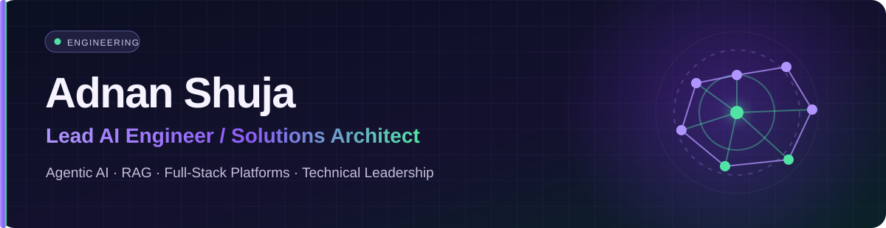

  

  
<strong>I build the systems around AI that make it useful in production.</strong>

  
10+ years in software engineering · Production AI platforms · Hands-on full-stack development · Engineering leadership

  

    
    
  

---

### What I work on

I’m a **Lead AI Engineer / Solutions Architect** who combines AI system design with hands-on application engineering. My work spans **agent orchestration, retrieval-grounded AI, product architecture, backend platforms, and developer experience**.

- **Production AI:** Design agentic workflows, RAG systems, tool integrations, human-in-the-loop checkpoints, evaluation, and observability.
- **Full-stack delivery:** Build applications and APIs with React, Next.js, TypeScript, Node.js, and Python.
- **Technical leadership:** Guide architecture decisions, review code, mentor engineers, and improve release processes across engineering and QA.
- **Reliability by design:** Favor deterministic workflow state, explicit contracts, observability, secure integrations, and automated delivery over demo-only AI.

### Engineering toolkit

| Area | Tools & technologies |
| :-- | :-- |
| **AI & agent systems** | LangGraph · CrewAI · MCP · A2A · LLM applications · RAG |
| **Knowledge & evaluation** | Pinecone · Qdrant · Langfuse · semantic caching · retrieval evaluation |
| **Applications** | TypeScript · JavaScript · Next.js · React · Node.js · Python |
| **Data & infrastructure** | PostgreSQL · Redis · Docker · GitHub Actions · CI/CD |
| **Architecture** | API design · workflow orchestration · microservices · human-in-the-loop systems |

### Selected engineering work

<table>
  <tr>
    <td width="50%" valign="top">
      <strong>🏛️ Government digital services</strong> 
      Professional work · Source code private
      
Engineering conversational AI and agent-powered experiences for public-sector digital services, with an emphasis on trustworthy retrieval, controlled tool execution, and platform-scale delivery.

    </td>
    <td width="50%" valign="top">
      <strong>🧭 AVA / GetAnyVisa</strong> 
      Product in development · Source code private
      
Building an AI-guided visa journey platform that combines pathway discovery, document understanding, structured workflows, and human support for complex processes.

    </td>
  </tr>
  <tr>
    <td width="50%" valign="top">
      <strong>🛡️ <a href="https://github.com/adnanshuja/disciplined-agents">Disciplined Agents</a></strong> 
      Public repository
      
An execution-discipline approach to AI-assisted coding: explicit scope, validation gates, justified changes, and traceable diffs.

    </td>
    <td width="50%" valign="top">
      <strong>⚙️ Engineering enablement</strong> 
      Architecture & team leadership
      
Improving delivery through automated deployments, practical code review standards, developer tooling, and maintainable full-stack architecture.

    </td>
  </tr>
</table>

### How I think about production AI

**Models are one component.** The product succeeds when the rest of the system is dependable.

1. **Ground decisions** in verified data, clear requirements, and explicit workflow state.
2. **Constrain actions** with typed tools, permissions, approvals, and auditable boundaries.
3. **Measure behavior** with traces, evaluations, tests, and operational feedback.
4. **Ship the whole product** — UI, APIs, infrastructure, CI/CD, and ongoing reliability.

### Currently focused on

**Agentic AI architectures** · **Reliable RAG** · **MCP/A2A integrations** · **AI platform engineering** · **Full-stack product delivery**

---

  <strong>Interested in production AI systems, architecture, or engineering leadership?</strong> 
  <a href="mailto:adnanshuja3@gmail.com">Let's talk</a> · <a href="https://github.com/adnanshuja">GitHub</a>

